# Video Animation

Sampel video dari beberapa skill animasi (Remotion, Blender, motion design). Klik GIF untuk memutar videonya (dengan suara kalau ada).

## Buatan sendiri

<table>
<tr><td align="center" width="50%"><a href="out/anak-kedua-blender.mp4">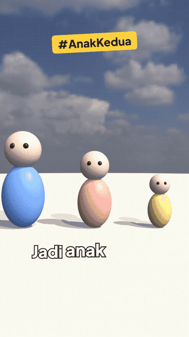</a> <b>#AnakKedua (3D)</b> Blender + Poly Haven + ElevenLabs + Remotion · Cerita sendiri, narasi Indonesia, caption per kata.</td><td align="center" width="50%"><a href="out/huashu-art-motion.mp4">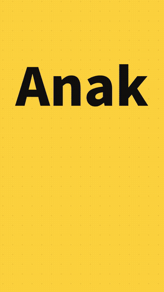</a> <b>Anak Kedua (tipografi)</b> huashu-art-motion · Kinetic type, tanpa suara.</td></tr>
<tr><td align="center" width="50%"><a href="out/lemo-opuscar.mp4">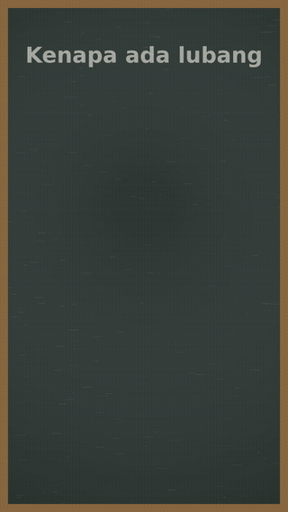</a> <b>Lubang tutup pulpen</b> lemo-opuscar · Gaya papan kapur, tanpa suara.</td><td align="center" width="50%"><a href="out/opus-video-skills.mp4">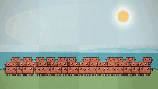</a> <b>Kalo misal semua orang Indonesia lompat bareng?</b> opus-video-skills · Animasi lukisan, tanpa teks.</td></tr>
<tr><td align="center" width="50%"><a href="out/onetake.mp4">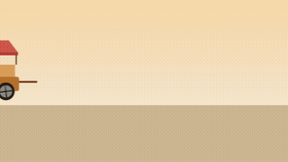</a> <b>Mulai dari gerobak</b> onetake · Satu shot tanpa potong.</td><td align="center" width="50%"><a href="out/explainroo.mp4">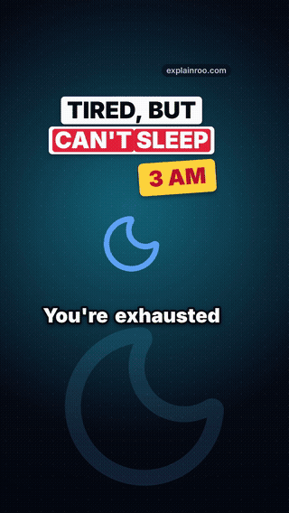</a> <b>Tired, but can't sleep</b> explainroo · Suara Kokoro lokal (English), musik, caption.</td></tr>
</table>

## Contoh bawaan skill

<table>
<tr><td align="center" width="50%"><a href="out/whatif-rewind.mp4">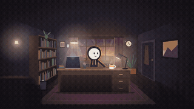</a> <b>What If: Rewind</b> what-if-animation · Contoh bawaan, lengkap suara + SFX.</td><td align="center" width="50%"><a href="out/whatif-copypaste.mp4">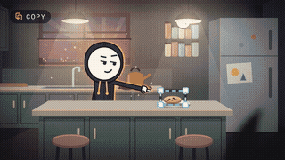</a> <b>What If: Copy Paste</b> what-if-animation · Contoh bawaan.</td></tr>
<tr><td align="center" width="50%"><a href="out/reelmimic.mp4">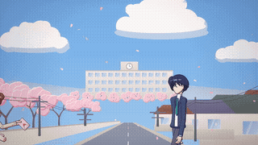</a> <b>Anime cel demo</b> reelmimic · Contoh bawaan, 3 shot.</td><td align="center" width="50%"><a href="out/riso-windowseat.mp4">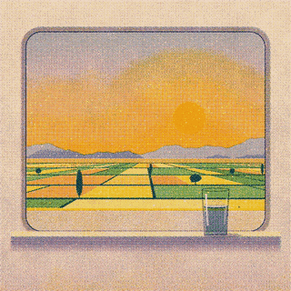</a> <b>Window Seat</b> riso-windowseat · Film risograph bawaan, 14 dtk pertama.</td></tr>
<tr><td align="center" width="50%"><a href="out/clawd-demo.mp4">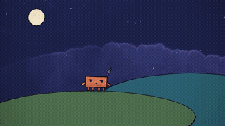</a> <b>Clawd (cat air)</b> ClaudeAnimationBase · Contoh bawaan; maskot Anthropic, cuma buat lihat gaya.</td><td align="center" width="50%"><a href="out/motiondesign-3d-toy-character.mp4">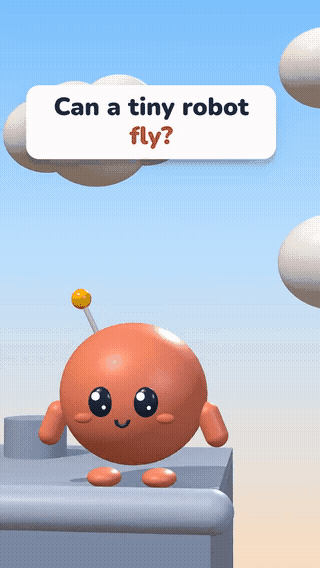</a> <b>Mainan 3D</b> motion-design-skills · Contoh bawaan.</td></tr>
<tr><td align="center" width="50%"><a href="out/motiondesign-hand-drawn-cartoon.mp4">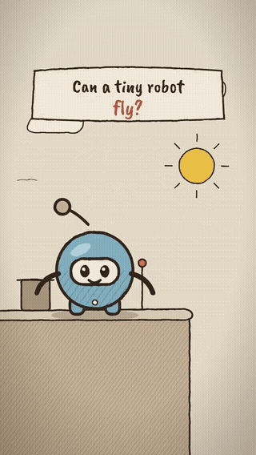</a> <b>Kartun gambar tangan</b> motion-design-skills · Contoh bawaan.</td><td align="center" width="50%"><a href="out/motiondesign-kinetic-typography.mp4">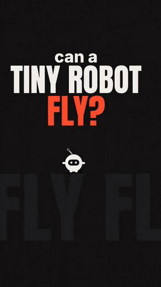</a> <b>Tipografi bergerak</b> motion-design-skills · Contoh bawaan.</td></tr>
<tr><td align="center" width="50%"><a href="out/motiondesign-system-diagram-animation.mp4">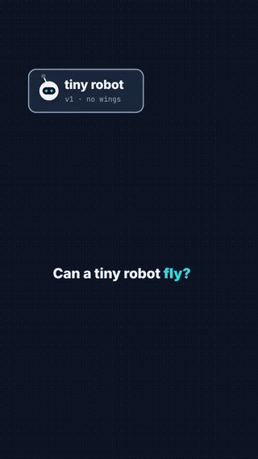</a> <b>Diagram</b> motion-design-skills · Contoh bawaan.</td><td align="center" width="50%"><a href="out/motiondesign-data-story-charts.mp4">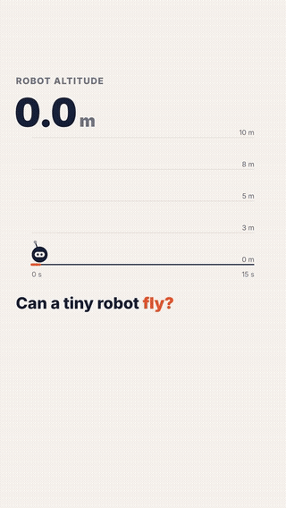</a> <b>Grafik data</b> motion-design-skills · Contoh bawaan.</td></tr>
</table>

Galeri lengkap dengan filter: buka `preview.html` di browser setelah clone repo ini.
